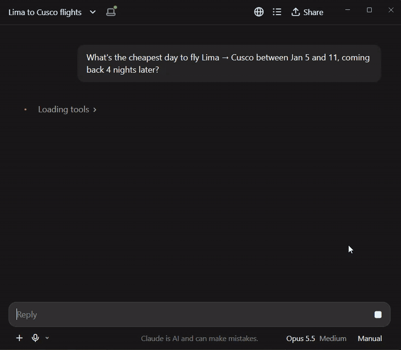

# flights-mcp-playwright ✈️

Search Google Flights from **Claude Desktop**, in plain language.



A small local [MCP](https://modelcontextprotocol.io) server that searches Google Flights in a **real browser**, so it gets the same results you see.

**Free · no account or API key · one file · runs on your own machine**

It uses [Playwright](https://playwright.dev/python/) to open Google Flights in a hidden Chromium browser, reads the results, and gives Claude a short, clean list of flights. Claude gets about 30 lines of data, not whole web pages, so searches use very few tokens.

> "Find me a round trip from Lima to Cusco, Jan 10–14"

```json
{
  "price": "117 US dollars round trip total",
  "airline": "LATAM",
  "stops": "Nonstop",
  "depart": "12:20 PM on Sunday, January 10",
  "arrive": "1:45 PM on Sunday, January 10",
  "duration": "1 hr 25 min"
}
```

## Why

Google Flights now loads its results with JavaScript inside the browser. Tools that read the raw page, like [fli](https://github.com/punitarani/fli), come back empty. This server uses a real browser, so it sees the same results you do.

## Features

- One-way and round-trip searches
- Filters: cabin class, number of adults, nonstop / max stops, max price, airlines
- **Cheapest-day finder**: scans up to 14 departure dates and tells you the cheapest one
- Price, airline, stops, departure and arrival times, duration, and layovers
- A Google Flights link with every search, so you can open it and book
- Any currency (`USD`, `PEN`, `EUR`, …)
- One file, no project setup: [uv](https://docs.astral.sh/uv/) installs the dependencies for you
- Runs on macOS and Windows

## Setup

### 1. Install uv

**macOS / Linux**
```bash
curl -LsSf https://astral.sh/uv/install.sh | sh
```

**Windows (PowerShell)**
```powershell
powershell -ExecutionPolicy ByPass -c "irm https://astral.sh/uv/install.ps1 | iex"
```

Restart your terminal afterwards.

### 2. Install the browser (one time, ~150 MB)

```bash
uv run --script https://raw.githubusercontent.com/snixxper/flights-mcp-playwright/main/flights_pw.py --install-browser
```

### 3. Test it

```bash
uv run --script https://raw.githubusercontent.com/snixxper/flights-mcp-playwright/main/flights_pw.py --test LIM MIA 2026-12-20
```

Add a return date for a round trip. Add `--show` to watch the browser work.

To find the cheapest day in a range (here: 4-night round trips leaving Jan 5–11):

```bash
uv run --script https://raw.githubusercontent.com/snixxper/flights-mcp-playwright/main/flights_pw.py --dates LIM CUZ 2027-01-05 2027-01-11 4
```

### 4. Add it to Claude Desktop

In Claude Desktop, open **Settings → Developer → Edit Config**, and add this inside `"mcpServers"`:

**macOS** (replace `YOUR_USER`)
```json
"flights-pw": {
  "command": "/Users/YOUR_USER/.local/bin/uv",
  "args": ["run", "--script", "https://raw.githubusercontent.com/snixxper/flights-mcp-playwright/main/flights_pw.py"]
}
```

**Windows** (replace `YOUR_USER`)
```json
"flights-pw": {
  "command": "C:\\Users\\YOUR_USER\\.local\\bin\\uv.exe",
  "args": ["run", "--script", "https://raw.githubusercontent.com/snixxper/flights-mcp-playwright/main/flights_pw.py"]
}
```

Use the full path to `uv`. Claude Desktop often can't find it otherwise. Run `which uv` (macOS) or `where uv` (Windows) to get yours.

Save the file, quit Claude Desktop completely, and reopen it. **flights-pw** should show as **Running** in Settings → Developer. Then just ask Claude for flights.

> Pointing the config at the GitHub URL means you always run the latest version. To pin a version, download `flights_pw.py` and use its local path instead.

## Tools

### `search_flights`

Flights for one date.

| Parameter | Example | Notes |
|---|---|---|
| `origin` | `"LIM"` | IATA airport code |
| `destination` | `"CUZ"` | IATA airport code |
| `date` | `"2027-01-10"` | `YYYY-MM-DD` |
| `return_date` | `"2027-01-14"` | Leave it out for one-way |
| `cabin` | `"business"` | `economy`, `premium_economy`, `business`, `first` |
| `adults` | `2` | Prices are the total for all passengers |
| `max_stops` | `0` | `0` = nonstop only, `1` = at most one stop |
| `max_price` | `500` | Drop flights above this total price |
| `airlines` | `["LATAM", "Copa"]` | Keep only these airlines |
| `currency` | `"PEN"` | ISO 4217 code |
| `max_results` | `10` | Top N results |

For round trips, prices are the total for both ways, and the list shows outbound flights.

### `find_cheapest_dates`

The cheapest flight for each departure day in a range, plus the cheapest day overall.

| Parameter | Example | Notes |
|---|---|---|
| `origin`, `destination` | `"LIM"`, `"CUZ"` | IATA airport codes |
| `start_date`, `end_date` | `"2027-01-05"`, `"2027-01-11"` | Up to 14 days |
| `trip_length` | `4` | Nights for a round trip. Leave it out for one-way |
| `cabin`, `adults`, `max_stops`, `currency` | | Same as above |

It loads 4 pages at a time, so a full week takes about 20–30 seconds.

> Example: *"What's the cheapest day to fly Lima → Cusco between Jan 5 and 11, coming back 4 nights later?"* → **Thu Jan 7, $117 round trip, LATAM nonstop**

## How it works

1. Builds a Google Flights URL from your search.
2. Opens it in headless Chromium and declines the cookie banner if one appears.
3. Waits for the results, then reads each result's accessibility label (`aria-label`). Google writes those labels in plain sentences, so they change less often than its CSS class names.
4. Turns each label into a small JSON object.

## Alternatives

There are several Google Flights MCP servers. Here's an honest guide to when each one fits:

| Option | How it gets data | Good when… | Trade-off |
|---|---|---|---|
| **This project** | Real headless browser (Playwright) | You want something free and local that sees what a browser sees | ~150 MB browser download; 5–10 s per search; can break when Google changes its page |
| [fli](https://github.com/punitarani/fli) | Direct requests to Google's internal API | You want a full Python library + CLI with lots of filters | Since Nov 2026, Google redirects its requests to an "unsupported" page ([#270](https://github.com/punitarani/fli/issues/270)) |
| [fast-flights](https://github.com/AWeirdDev/flights) and MCP servers built on it | Encoded Google Flights URLs | You want a fast, lightweight Python library | The README notes a proxy is usually needed to avoid bot detection |
| SerpAPI / hosted APIs (e.g. HasData) | Paid scraping service | You need reliable uptime or high volume | Needs an account and API key; free tiers are limited |

If this one stops working, check the [issues](https://github.com/snixxper/flights-mcp-playwright/issues), or use one of the paid options as a fallback.

## Limitations

- **It can break.** It depends on how Google Flights builds its page. If the results come back empty, Google probably changed something. Please open an issue.
- **Personal, low-volume use only.** This reads Google Flights pages, which Google's terms of service don't allow. Too many searches may get you a captcha or a temporary block.
- Each search takes about 5–10 seconds while the browser loads.
- Multi-city searches aren't supported yet.
- The cheapest-day finder runs one search per day, so keep ranges short (it's capped at 14 days).

## License

[MIT](LICENSE) © snixxper
